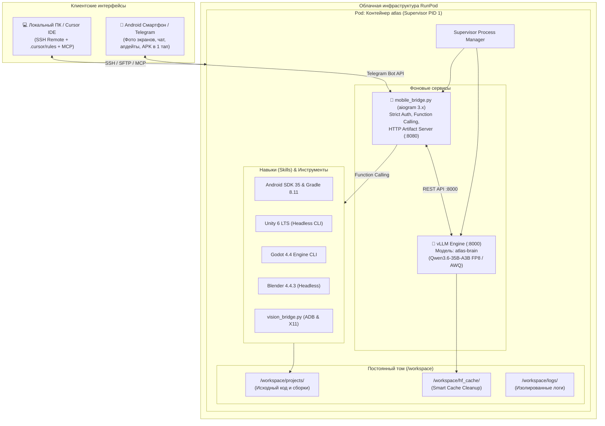

# ⚡ ATLAS — Autonomous Vibe-Coding Environment

[](https://github.com/graffgrey87/Project-ATLAS/actions/workflows/docker-build.yml)
[](LICENSE)
[](https://hub.docker.com/r/runpod/pytorch)
[-purple)](https://huggingface.co/Qwen)

**ATLAS** — автономная облачная среда для vibe-кодинга, функционирующая на GPU-инстансах **RunPod** (от 48 ГБ суммарной VRAM, CUDA 13.0) в едином изолированном Docker-контейнере. Среда управляется локально с ПК через **Cursor IDE** (по SSH) и удалённо со смартфона **Android** через защищенный Telegram-мост.

---

## 🏛 Архитектура системы



---

## 🚀 Ключевые возможности

1. **Zero-Config адаптация к любому GPU (на базе PyTorch)**:
   - Анализ оборудования выполняется строго через встроенные вызовы PyTorch, минуя хостовый `nvidia-smi`.
   - **`compute_cap >= 8.9`** (Ada Lovelace, Hopper, Blackwell: L40, L40S, RTX 6000 Ada, 2× RTX 4090, H100):
     - Модель: `Qwen/Qwen3.6-35B-A3B-FP8` (~33.5 ГБ);
     - Флаг `--kv-cache-dtype fp8`;
     - Минимальный порог памяти: **44 000 МБ**.
   - **`compute_cap < 8.9`** (Ampere: A40, RTX A6000, A100, 2× RTX 3090):
     - Модель: `QuantTrio/Qwen3.6-35B-A3B-AWQ` (~25 ГБ);
     - Стандартный KV-кэш;
     - Минимальный порог памяти: **28 000 МБ** (блокирует одиночную карту 24 ГБ во избежание OOM).
   - Автоматический расчет `--tensor-parallel-size` под число выделенных карт (1× 48 ГБ или связка 2× 24 ГБ).
   - Расширение контекста `--max-model-len 65536` для карт с VRAM ≥ 75 ГБ.

2. **Smart Cache Cleanup (контроль диска RunPod)**:
   - Проверка свободного места на постоянном диске `/workspace` перед скачиванием весов.
   - Если свободно менее 40 ГБ — старые неиспользуемые модели в `hf_cache/hub` удаляются автоматически.

3. **Telegram Mobile Bridge (aiogram 3.x)**:
   - **Строгая безопасность**: доступ разрешён строго по числовому `ALLOWED_TELEGRAM_ID` (integer, защита от GHSA-mj5r-hh7j-4gxf / смены username).
   - **Vision VLM**: прямая отправка скриншотов с телефона с распознаванием UI и генерацией правок.
   - **Function Calling**: бот самостоятельно читает/пишет файлы в `/workspace`, создаёт коммиты в Git и запускает сборку проектов.
   - **Доставка APK**: сборки до 50 МБ высылаются прямо в чат для установки в один тап; сборки > 50 МБ отдаются по защищенной ссылке через встроенный сервер `:8080` и RunPod Proxy.

4. **Автономные Skills (навыки агента)**:
   - `skills/compile_android.py`: сборка Android Gradle проекта, точечное извлечение ошибок компиляции Kotlin/Java.
   - `skills/unity_build.py`: headless сборка Unity с автоактивацией лицензии (Personal `.ulf` или Plus/Pro серийный номер).
   - `skills/blender_render.py`: headless рендер сцен Cycles/EEVEE и исполнение Python-скриптов.
   - **Единый JSON-контракт**: в контекст агента передаётся только структурированный JSON, полные логи пишутся в `/workspace/logs/`.

5. **Официальные MCP-серверы для Cursor IDE**:
   - `github`: официальный `ghcr.io/github/github-mcp-server:latest`.
   - `playwright`: `@playwright/mcp@latest` через `npx` с флагом `--headless`.
   - `blender`: официальный сервер Blender Lab (`projects.blender.org/lab/blender_mcp`).

---

## 📋 Таблица совместимости GPU на RunPod

| Конфигурация GPU | Compute Cap | Суммарная VRAM | Выбранная квантизация | KV-Кэш | Контекст | Статус |
| :--- | :---: | :---: | :---: | :---: | :---: | :---: |
| **1× L40 / L40S (48 ГБ)** | 8.9 | ~46 000 МБ | **FP8 (Official)** | fp8 | 32 768 | ✅ Идеально |
| **1× RTX 6000 Ada (48 ГБ)** | 8.9 | ~48 000 МБ | **FP8 (Official)** | fp8 | 32 768 | ✅ Идеально |
| **2× RTX 4090 (48 ГБ)** | 8.9 | ~48 000 МБ | **FP8 (Official)** | fp8 | 32 768 | ✅ Идеально (TP=2) |
| **1× H100 SXM / PCIe (80 ГБ)**| 9.0 | ~80 000 МБ | **FP8 (Official)** | fp8 | 65 536 | 🚀 Максимум (TP=1) |
| **1× A40 / RTX A6000 (48 ГБ)**| 8.6 | ~46 000 МБ | **AWQ 4-bit** | default | 32 768 | ✅ Поддерживается |
| **2× RTX 3090 (48 ГБ)** | 8.6 | ~48 000 МБ | **AWQ 4-bit** | default | 32 768 | ✅ Поддерживается (TP=2) |
| **1× A100 (40 ГБ)** | 8.0 | ~40 000 МБ | **AWQ 4-bit** | default | 32 768 | ✅ Поддерживается |
| **1× RTX 4090 / 3090 (24 ГБ)**| Любой | ~24 000 МБ | — | — | — | ❌ Блокируется (OOM) |

---

## 🛠 Быстрый старт

### Шаг 1. Клонирование и настройка переменных

```bash
git clone https://github.com/graffgrey87/Project-ATLAS.git
cd Project-ATLAS
cp .env.example .env
```

Отредактируйте файл `.env`:
```env
# Токен бота Telegram от @BotFather
TELEGRAM_BOT_TOKEN=123456789:ABCdefGHIjklMNOpqrsTUVwxyz

# Ваш числовой ID в Telegram (узнать в @userinfobot)
ALLOWED_TELEGRAM_ID=987654321

# Персональный токен GitHub для MCP и синхронизации
GITHUB_TOKEN=ghp_yourPersonalAccessTokenHere

# Unity: содержимое .ulf файла для Personal или данные лицензии
UNITY_LICENSE=
```

### Шаг 2. Развертывание на RunPod

1. Перейдите в панель [RunPod Console](https://www.runpod.io/console/pods) и нажмите **Deploy**.
2. Выберите GPU с VRAM от 48 ГБ (рекомендуется **1× L40S** или **2× RTX 4090**).
3. Укажите Docker Image:
   ```text
   ghcr.io/graffgrey87/project-atlas:latest
   ```
4. Настройте хранилище:
   - **Container Disk**: от 30 ГБ.
   - **Volume Disk (Persistent)**: от 100 ГБ, монтируется в `/workspace`.
5. В разделе **Environment Variables** добавьте переменные из файла `.env`.
6. Откройте порты: `8000` (vLLM API), `8080` (Artifact Server), `22` (SSH).
7. Запустите Pod. Скрипт `entrypoint.sh` автоматически определит видеокарты, загрузит модель и запустит Supervisor.

---

## 💻 Подключение из Cursor IDE

1. **Подключение по SSH**:
   В Cursor нажмите `F1` → `Remote-SSH: Connect to Host...` и вставьте строку подключения RunPod (например `root@<ip> -p <port>`). Откройте каталог `/workspace`.
2. **Активация ролевых правил (.cursor/rules/)**:
   Встроенные правила автоматически включаются при открытии соответствующих файлов:
   - `context-management.mdc`: работает всегда (`alwaysApply: true`), контролируя чтение памяти и расход контекста;
   - `unity-senior.mdc`: активируется при редактировании скриптов C# и сцен Unity;
   - `android-expert.mdc`: активируется в проектах Android (Kotlin, Compose, Gradle);
   - `blender-tech-artist.mdc`: активируется при работе с 3D-ассетами и скриптами `bpy`;
   - `researcher.mdc`: включается для оформления архитектурных документов ADR.
3. **Активация MCP-серверов**:
   Убедитесь, что файл [`.cursor/mcp.json`](.cursor/mcp.json) распознан Cursor (Settings → Features → MCP). Подробности в [docs/mcp-setup.md](docs/mcp-setup.md).

---

## 📱 Удалённое управление со смартфона (Telegram)

- Откройте чат с созданным ботом в Telegram и отправьте `/start`.
- **Команды и возможности**:
  - **Текст**: ставьте задачи на естественном языке (*"Создай новый экран авторизации в проекте Android в Compose"*).
  - **Фото**: прикрепляйте скриншоты ошибок или макеты с пояснением.
  - **Сборка**: бот самостоятельно запускает `skills/compile_android.py`, коммитит изменения в Git и присылает готовый файл APK в чат.
  - `/clear`: сброс истории текущей сессии для очистки контекста.

---

## 📁 Структура проекта

```text
Project ATLAS/
├── .cursor/
│   ├── rules/                 # Ролевые промпты Cursor (.mdc с YAML frontmatter)
│   │   ├── android-expert.mdc
│   │   ├── blender-tech-artist.mdc
│   │   ├── context-management.mdc (alwaysApply: true)
│   │   ├── researcher.mdc
│   │   └── unity-senior.mdc
│   └── mcp.json               # Конфигурация MCP-серверов (GitHub, Playwright, Blender)
├── .github/workflows/
│   └── docker-build.yml       # CI/CD: автосборка образа в GHCR при пуше в main
├── docker/
│   ├── Dockerfile             # Сборка окружения (Ubuntu 24.04, PyTorch 2.13, CUDA 13.0)
│   ├── entrypoint.sh          # Zero-config GPU адаптация через PyTorch + Smart Cache Cleanup
│   └── supervisord.conf       # PID 1: управление процессами vLLM и mobile_bridge
├── docs/
│   ├── adr/                   # Архитектурные решения (ADR-001 .. ADR-005)
│   ├── architecture.md        # Детальная архитектурная схема и потоки данных
│   ├── conventions.md         # Соглашения по коду, git-flow и языкам
│   ├── known-issues.md        # Известные особенности и решения (Unity лицензия и др.)
│   └── mcp-setup.md           # Руководство по настройке и запуску MCP-серверов
├── sessions/                  # Журналы сессий компакции контекста
├── skills/                    # Библиотека автономных навыков (Function Calling)
│   ├── _schema.json           # JSON Schema единого контракта отчётов
│   ├── skill_utils.py         # Утилиты форматирования отчётов и изоляции логов
│   ├── compile_android.py     # Сборка Android Gradle проектов с извлечением ошибок
│   ├── unity_build.py         # Headless-сборка Unity с автоактивацией лицензии
│   └── blender_render.py      # Headless-рендер Cycles/EEVEE и скрипты bpy
├── src/
│   ├── mobile_bridge.py       # Telegram-бот: Vision, Function Calling, отдача APK
│   └── vision_bridge.py       # Захват скриншотов эмулятора/X11 с crop-оптимизацией
├── .dockerignore              # Исключения сборки контейнера
├── .env.example               # Шаблон переменных окружения
├── .gitattributes             # Нормализация окончаний строк LF
├── .gitignore                 # Исключения Git
├── docker-compose.yml         # Локальная оркестрация контейнера
├── PROJECT_MEMORY.md          # Единственный источник истины для агента (≤300 строк)
└── README.md                  # Главная документация проекта
```

---

## 📄 Лицензия

Проект распространяется под лицензией MIT. Подробности в файле [LICENSE](LICENSE).
